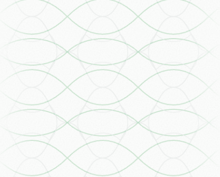
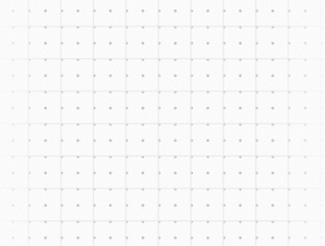

# Folune Landing 侧导轨改进 Plan

> 日期：2026-09-20。
> 状态：2026-09-22 用户确认保留大波纹、仅缩小小波纹，并授权单独提交侧导轨修改。当前大小弧为 18/14.25，纵向周期为横向的 15/16，两端各 16% 渐隐。前轮构建与 git diff --check 通过，历史页面参数与小样检查不覆盖最终微调；第 1～11 节为历史计划，冲突时以第 12 节当前参数为准。
> 交付：原始计划、用户参考、LandingRailTexture 与三处装配；无动画、无额外依赖。

<!--
[INPUT]: 用户确认的方向一、横纵交织与网格点阵补充、当前 Landing 结构及 app/brand-spec.md
[OUTPUT]: 三个目标区块的视觉规则、实现参数、渐隐与响应式策略、验收条件及执行记录
[POS]: landing-refactor 的侧轨设计与实施记录；第 1～11 节保留决策依据，第 12 节说明当前实现和证据边界
[PROTOCOL]: 变更时更新此头部，然后检查 CLAUDE.md
-->

## 1. 目标与已确认决策

让两侧导轨成为 Folune 视觉语言向页面边缘的自然延伸。远看是安静的秩序，近看能发现线条、交点、疏密和渐隐之间的设计；滚动时微弱提示章节变化，正文始终先被看见。

只增加三个区块：团队与用户评价、六格指南、首页博客。选择方向一「纸张逐渐形成秩序」，以纸缘线、交织缓弧、索引格点三个母题统一整页。

用户补充已覆盖早期过度简化的描述：

1. 指南区必须同时存在横向主曲线与纵向次曲线，保留有规律的收拢、展开和交织关系；不能退化为两三根独立竖向缓弧。
2. 博客区必须同时存在完整正方网格和更密的点阵；不能删掉方格，只留下散点或零星线段。
3. 每一侧纹样区域自身都要左右渐隐；不能只向屏幕外侧淡出，也不能整块统一降透明度代替渐隐。
4. 克制主要通过线条强弱、层次、密度和渐隐实现，不以删除关键结构换取空白。
5. 不重新开放其他方向，不增加与本次母题无关的符号或装饰。

## 2. 当前依据与证据边界

编写时重新读取当前源码与品牌规范。当前指南已是分类、序号和小幅线稿组成的紧凑六格；关联展示已是左侧叙述、右侧双纸面布局。实施应接在这些最新结构上，不恢复讨论初期的旧版排版。

| 来源 | 当前职责及与本计划的关系 |
| --- | --- |
| [brand-spec.md](../../brand-spec.md) | 暖灰画布、清楚纸面、Soft Ink 墨蓝与克制材质的品牌依据 |
| [LandingPage.tsx](../../src/pages/LandingPage.tsx) | BlueprintFrame 内装配 Hero 与后续区块 |
| [BlueprintFrame.tsx](../../src/widgets/BlueprintFrame.tsx) | 主轨、外轨的唯一纵向骨架；新纹样复用其坐标 |
| [BlueprintDivider.tsx](../../src/widgets/BlueprintDivider.tsx) | 横向分隔线、斜纹带与菱形交点；保持现状 |
| [LandingSections.tsx](../../src/widgets/LandingSections.tsx) | 评价区及全页内容顺序；只在评价区接入纹样 |
| [LandingGuides.tsx](../../src/widgets/LandingGuides.tsx) | 六格方法目录，承载交织纹样 |
| [LandingBlog.tsx](../../src/widgets/LandingBlog.tsx) | 首页三篇精选，承载网格点阵 |
| [GuideIllustration.tsx](../../src/widgets/GuideIllustration.tsx)、[BlogCover.tsx](../../src/widgets/BlogCover.tsx) | 现有纸页、路径、细网格语言；借用关系，不修改原插画 |
| [landing.css](../../src/styles/landing.css) | 1120px 主轨、48px 外轨内缩、暖灰底色、墨蓝及区块样式 |

此前讨论已查看运行页 DOM，并截看评价和指南；博客截图未成功，其判断来自组件、封面和样式。本轮编写文档未重新做浏览器验收，后续必须用实施时的当前页面验收。

参考图只证明可见构成，不证明 Laper 使用的 SVG、CSS 或具体数学公式。下文技术路径是 Folune 的实现选择。

### 2.1 指南参考：横纵两个方向的周期结构

- 横向较明显的曲线成对起伏，以相同形状、幅度和间距重复；早期“饱满与扁长交替”的判读已由用户纠正。
- 纵向较淡的曲线规律收拢、展开，形成梭形或束腰结构。
- 周期和相位受同一套坐标约束；视觉复杂度来自两层叠合，不来自随机形变。
- 局部左右边缘逐渐变淡；底色自然透出，不出现花纹矩形的硬边。

### 2.2 博客参考：方格与点阵共用坐标

- 底层是完整、连续的正方格线，上层是较明显的小点阵。
- 参考图中方格边长约为点距两倍；点落在格子交点、边中点和内部中心。
- 线弱、点略强；远看有颗粒，近看有秩序。
- 两层共同左右渐隐，不让一层形成硬边、另一层单独消失。

原图保持原样保存，仅作为研究依据，不直接作为生产背景贴图。截图物理像素不能直接当成 CSS 尺寸。

## 3. 应用范围与留白节奏

| 页面顺序 | 区块 | 决策与原因 |
| --- | --- | --- |
| 1 | 首屏、三项价值说明 | 保留现状；颗粒波面已延伸到外轨，短说明负责清晰起步 |
| 2 | APP 互动展示 | 留白；三栏界面与后景已有足够信息 |
| 3 | 团队与用户评价 `#community` | 加纸缘线；以纵向秩序承托中心长卡片及并置引语 |
| 4 | 五项功能与补充说明 `#features` | 留白；截图、虚线框、分格已经形成结构 |
| 5 | 关联展示 `#workflow` | 留白；保留两张纸之间的关联线作为主角 |
| 6 | 四项功能细节 `#feature-details` | 留白；展开项点阵与展示图已承担变化 |
| 7 | 六格指南 `#guides` | 加横纵交织缓弧；提示从产品体验进入方法阅读 |
| 8 | 创作者信 `#resources` | 完整留白；纸层、印记、斜纹边框足够，同时隔开指南与博客 |
| 9 | 首页博客 `#blog` | 加完整网格与索引点阵；延续封面秩序，表达内容被收录 |
| 10 | 末端 CTA 与 Footer | 保留现状；CTA 聚焦行动，Footer 墨蓝与斜纹完成收尾 |

整体节奏：首屏与演示 → 纸缘线 → 产品段留白 → 交织缓弧 → 信件留白 → 索引格点 → CTA 留白。

留白区保留已有纸纹和骨架，不额外铺统一点阵。只影响首页，不能把纹样扩散到 `/blog` 目录、文章页或 APP。

## 4. 统一视觉规则

三个母题的递进关系：评价以纵向为主，指南让横纵方向交织，博客让横纵关系落入规整格网。它们共用颜色、线宽、尺度基准与渐隐方法，不各自发明一套材质。

| 项目 | 设计起点 | 约束 |
| --- | --- | --- |
| 底色 | 当前 `--landing-bg`，编写时为 `#f4f4f2` | 透明纹样覆盖原底色，不新增色板 |
| 颜色 | `--landing-accent` → `--primary`，浅色为 `#395875` | 次级灰蓝由同色低透明度得到；不新增绿色、青紫或强调色 |
| 线宽 | 1 CSS px | 用透明度控制轻重，避免靠极细描边造成高 DPI 或缩放时断线 |
| 基础步长 | 16px，服从现有 4px 基准 | 间距优先 16／32／48px，周期优先 64／96px 及其倍数 |
| 主线透明度 | 10%～14%，起始 12% | 指纹样中间最清晰处、渐隐前的线条透明度 |
| 次线透明度 | 4%～7%，起始 5% | 必须近看可辨，不能被纸纹完全吞没 |
| 点径 | 1～1.5 CSS px，起始 1.2px | 全部相同，不加入随机大小与随机亮点 |
| 材质 | 现有纸纹继续贯穿 | 不新增噪声层、浮雕、高光、发光、阴影或模糊滤镜 |
| 左右关系 | 同一标高、周期与显隐包络 | 曲线可以镜像；不做左右各自独立的随机构图 |

数值是小样起点，不是已验证定稿。保留层级关系与尺度比例比锁死某个透明度更重要。视觉调整顺序是结构 → 密度 → 层级 → 渐隐 → 总体强弱。

## 5. 三个区块的纹样规格

### 5.1 评价区：主线与伴随线组成纸缘

- 主结构是平行细纵线，呼应中央长卡片与纸页边缘。
- 用 16／32px 的规律组距形成疏密，不画等宽、等深的密集栅栏。
- 主线旁可有一条更淡的伴随线，间隔从 4px 起试；伴随线只提供纸缘层次，不做亮暗相夹的立体折痕。
- 主线从 10%～12%、伴随线从 4%～6% 起试，整组再经过共同的左右与上下渐隐。
- 1440px 下每侧以约 3～5 根主线为起点，数量由可用宽度和组距决定，不固定所有视口数量。
- 不增加节点、箭头、刻度或纸张轮廓；不让每条引语对应一个独立符号。

预期感受：稳定、并置、有所承托。若远看像百叶窗或条形码，先拉开组距、降低伴随线强度。

### 5.2 六格指南：横向主曲线与纵向次曲线交织

- 横向层由成对的周期缓弧组成，让展开与收拢交替出现；保留透镜形负空间，不只画几根同向正弦线。
- 纵向层更淡，以规律的束腰、梭形变化穿过横向层，形成参考图中能近看辨认的第二套结构。
- 两层共享周期体系与固定相位；交点和开口有规律，不用随机偏移制造丰富度。
- 以 96×96 CSS px 的无缝重复单元起试，内部优先使用 16／32／48px 关系；若窄导轨无法看清交织，比较 64px 周期，不能把整张 SVG 横向压扁。
- 主层起始 12%，次层起始 5%；次层置于主层之下，交点自然叠加，不加实心节点或额外高亮。
- 重复单元两端的位置与切线方向必须连续，避免接缝、拐折和叠线突然加深。
- 单元内部的弧幅、相位与纵向层的对应关系在小样阶段校准；不宣称这是参考站的原始算法。
- 一整个指南区共用纹样，不随六张卡片更换花纹。两排卡片之间也不人为切断。

预期感受：有规则的展开与连接。近看能分别追踪横向和纵向曲线，远看融入纸面。若像密集鱼鳞、DNA 绳结或装饰花边，先调整周期与相位，再调透明度，不删掉纵向层。

### 5.3 博客区：完整方格与双倍密度点阵

- 方格起始 32×32 CSS px，点距 16px；维持 2:1 比例。
- 点与方格共用原点，落在格子交点、边中点和内部中心，不错位或随机散布。
- 方格线起始 5%，点起始 12%；线宽 1px、点径 1.2px。
- 两层覆盖整个目标纹样范围，完整方格在渐隐前连续存在；不得用少量短线替代方格。
- 点与方格共同经过渐隐，线点原点固定，不随滚动漂移。
- 与博客封面的细网格形成亲缘关系，不要求复制封面的实际缩放密度，不改封面图案。

预期感受：内容进入索引、被整理收录。若远看成为两条灰带，优先减弱网格和点的总色量，必要时同比例放大格距与点距。

## 6. 渐隐与滚动连续性

### 6.1 每侧都必须具备双边渐隐

从正文向屏幕边缘依次为：主轨 → 净空 → 极淡纹样 → 较清晰的结构 → 极淡纹样 → 净空 → 外轨。

主轨与外轨自身不参与渐隐。只对纹样层施加透明度包络；既有菱形节点和横向分隔线保持现状。

起始横向包络：纹样区域 0% 为透明，约 25% 达到该层设定强度，25%～75% 维持主要可读区，100% 回到透明。用中间过渡点柔化显隐，不以明显模糊代替透明度变化。

两侧各自有一套完整包络，不用横跨整张页面的大渐变代替。纸缘主伴线、指南横纵线、博客线点均先分配内部强弱，再共同经过同一包络。

### 6.2 上下收尾与分隔带

- 区块顶部留 24～40px 安静起步，从 32px 起试；之后约 64～96px 内逐渐显现，从 80px 起试。
- 底部对称收淡，在分隔带前留干净区域，不让曲线交点、格点与菱形节点叠成深色结。
- 若区块高度变化，上下包络跟随容器；较短区域缩短淡入淡出距离，保留可辨的中段，不能只剩一团淡雾。
- 跨相邻区块用留白完成过渡，不强迫曲线变形成点阵。连续的是导轨坐标、颜色与线宽，不是一根必须穿过全页的装饰线。
- 所有纹样静止，随正常文档滚动。无绘制动画、视差、固定背景、循环运动或滚动驱动形变。

## 7. 宽度与响应式

复用现有变量，不新增第二套正文宽度或外轨位置。当前几何关系：

- 主内容宽度为 `--blueprint-content-width`，桌面上限 1120px。
- 主轨距视口边缘为 `--blueprint-main-inset`。
- 外轨距视口边缘为 `--blueprint-edge-inset`，当前 48px。
- 单侧轨间宽度 R = 主轨内缩 − 外轨内缩；纹样只出现在 R 为正的区域。

| 视口宽度 | 当前轨间宽度 R | 建议表现 |
| --- | --- | --- |
| 1920px | 352px | 增加固定尺寸重复单元，维持双边渐隐与总体轻度，不拉伸纹样 |
| 1440px | 112px | 主要校准宽度；两边各留约 12～16px 净空后，仍能辨认核心结构 |
| 1366px | 75px | 减少可见单元，整组额外降低强度；保持比例 |
| 1280px | 32px | 空间不足，关闭新增纹样，保留现有导轨 |
| ≤1232px | 外轨按现有规则隐藏 | 新纹样一并退出，不挤入正文或改成移动端卡片背景 |

建议以 R≤64px 隐藏、64px＜R＜112px 连续提高整体可见度、R≥112px 达到标准强度作为试排起点。用共享几何变量与 CSS 推导，避免为了测量纹样另加 resize/scroll 状态。

宽屏允许增加重复数量，不把整个图案限制成固定细条；同时不能因为可用区域变大而同步提高不透明度。若宽屏形成明显纹样带，扩大渐隐范围并减少中段色量。

保留既有正文宽度、区块 padding、高度、文字换行与卡片布局。新增层不能撑开页面、产生横向滚动或改变锚点位置。

## 8. 实现方案与文件边界

### 8.1 一个局部组件，三个明确变体

建议新增 `app/src/widgets/LandingRailTexture.tsx`，仅对外提供 `paper | weave | index` 三种语义变体。组件持有两侧纹样及共用显隐壳，目标 section 只选择变体，不复制各自的定位与遮罩逻辑。

优先用静态 SVG `<pattern>`：纸缘为线组、指南为两个方向的曲线组、博客为网格和点阵组。固定用户坐标尺寸，通过重复覆盖可用区域；避免非等比缩放。SVG 定义使用 `useId` 隔离左右与多实例引用。

颜色经 `currentColor` 消费 Landing 既有墨蓝；变体的主次透明度集中在 Landing 局部样式中。无需外部图片请求、新库、Shader、Canvas 或状态管理。

### 8.2 几何与显隐职责

- 目标 section 作为局部定位参照，纹样绝对定位到其左右轨间，垂直范围由实际 section 高度决定。
- 纹样脱离正常布局，并局部裁剪；不能给整个内容 section 增加 overflow 裁剪而截断卡片、阴影或焦点轮廓。
- 共用外壳负责横向渐隐，内部一层负责纵向渐隐，避免多重 mask 默认组合造成意外叠加。
- 优先 CSS mask；不支持时隐藏纯装饰层，保留骨架与内容，不显示无渐隐的完整花纹带。
- 层序保持在内容与导轨之下、页面底色之上；不得用负层级让纹样消失到根背景后，也不得将它提到全局纸纹或导航之上。
- 装饰根节点 `aria-hidden="true"`、`pointer-events:none`，SVG 不可聚焦；不参与 Tab 顺序，不拦截选择、滚动和点击。

### 8.3 预期文件改动

| 文件 | 实施时的预期变化 |
| --- | --- |
| `app/src/widgets/LandingRailTexture.tsx` | 新增三变体静态纹样、唯一 ID 与左右显隐壳 |
| `app/src/widgets/LandingSections.tsx` | 仅在 `#community` 装配纸缘纹样 |
| `app/src/widgets/LandingGuides.tsx` | 装配交织纹样，保持最新六格布局 |
| `app/src/widgets/LandingBlog.tsx` | 装配索引纹样，保留现有链接与返回协议 |
| `app/src/styles/landing.css` | 集中新增纹样参数、坐标、层序、显隐与宽度退让规则 |
| 对应文件 L3 与 `widgets/CLAUDE.md`、`styles/CLAUDE.md` | 同步真实依赖、职责与成员变化 |
| `app/brand-spec.md` | 实现验收后记录最终视觉规则，不提前把试排参数写成品牌定稿 |
| 本计划与 `landing-refactor/CLAUDE.md` | 补充实施状态、最终参数、验收记录与实际新增文件索引 |

`BlueprintFrame`、`BlueprintDivider` 继续独占骨架；优先直接消费其已有 CSS 坐标，不改公共 API，不在通用 Frame 中默认启用纹样。首页以外不应因共享 MarketingLayout 而受到影响。

## 9. 执行顺序与交付物

以下为原计划执行顺序；用户已于 2026-09-20 要求执行，实际进度见第 12 节。

1. **核对现场。** 重新读取相关目录地图、L3、当前 diff 与运行页。记录实际区块顺序、尺寸及现有改动，不覆盖其他工作，不沿用旧截图当基线。
2. **形成小样。** 在真实三个区块宽度和原有纸纹上比较结构，优先确认指南横纵两层和博客完整网格。对比只围绕已选方向的密度与强弱，不新增候选系统或公开调参界面。
3. **检查整页。** 同时看局部、正常阅读距离和跨区块滚动，确认三处的视觉重量与留白节奏，再冻结单元、透明度、渐隐参数。
4. **收口实现。** 用同一个组件与同一组几何规则接入三处；删去临时小样参数分支，生产不保留调试旋钮。
5. **完成验证与文档回环。** 执行第 10 节；先同步 L3，再检查 L2，最后检查 L1。未新增顶级模块时不为形式改写全局地图。

实施交付至少包含：三处当前页面截图、1440px 整页或连续滚动证据、1920px 宽屏与1366px退让证据、窄屏不溢出的检查、最终参数表及未验证项。证据文件如写入仓库，必须加入所在目录地图。

## 10. 验收与品味自检

### 10.1 视觉验收

- [ ] 只有评价、指南、首页博客三处新增纹样；产品段、信件与 CTA 的留白完整保留。
- [ ] 指南近看能分别追踪横向主曲线与纵向次曲线，周期连续，没有被简化成单层波浪。
- [ ] 博客近看能辨认完整方格和更密点阵，点距与格距维持 1:2，原点对齐。
- [ ] 每一侧都从两边向中间逐渐显露，线与点一起收尾；主轨、外轨、菱形节点没有跟着变淡。
- [ ] 正常阅读时先看到标题、卡片和正文；缩小看整页时没有两条显著深色花纹带。
- [ ] 密度更高的博客在总体视觉重量上不压过评价；指南虽最有变化，也不抢六幅卡片线稿。
- [ ] 横向双边渐隐与纵向收尾自然相交，没有矩形硬边、脏角、明显亮斑或突然切断。
- [ ] 全页滚动没有花纹跳动、贴屏漂移或各区块轮番出现的生硬背景块。

### 10.2 几何与浏览器验证

- [ ] 检查 1440／1920px 的结构，1366px 的弱化，1280／1232px 附近的退出；手机至少检查 390px。
- [ ] 100% 与 125% 缩放下不出现明显摩尔纹、断线或交点异常加深；可用时检查 1×／2× 像素密度。
- [ ] 前后正文宽度、区块位置和高度一致，无横向溢出、内容重排或锚点偏移。
- [ ] 指南与博客链接、焦点轮廓、文字选择不受装饰层影响。
- [ ] `/blog` 及任一文章页没有新增侧纹；Reduced Motion 下仍为同一静态结果。
- [ ] Chromium 完成主要视觉检查；Safari 可用时检查 mask、裁剪和 SVG 引用，否则明确列为未验证。

### 10.3 工程验证

从 `app/` 运行 `bun run typecheck`、`bun run lint`、`bun run build`，对实际修改执行 `git diff --check`。失败应区分本次变更与既有问题，不以删除检查或调整无关功能求通过。

纯装饰变更不新增镜像 CSS 数值的单元测试，不扩展到 API、Chat 或数据库测试；视觉正确性以当前页面证据为准。参数或结构最后一次调整后，重新检查受影响区块，不能把早先截图当作最终版本验收。

## 11. 调整原则与停止范围

若效果过重，依次检查密度、主次对比、渐隐范围；不要删掉已确认的纵向曲线或完整网格。若效果完全看不见，先检查叠乘透明度、遮罩与层序，再小幅提升局部强度，不直接把所有层一并加深。

不改正文、卡片内容、封面、品牌资产、导航、认证、API 或 APP；不趁机修复其他设计问题。不自动发布，不混合提交现有工作区中的其他改动。

计划完成条件：结构与范围已明确、参考图可直接查看、参数起点与待验收状态分开、实现文件边界与验收路径可执行。实现完成条件：三处实际接通、最后版本通过相关检查与视觉验收、最终参数和未验证项如实回写。

## 12. 实施记录（2026-09-21）

### 已接通的结构

`LandingRailTexture` 只由评价、指南与首页博客装配，共用 Blueprint 轨间定位和仅横向渐隐的装饰壳。纸缘与索引用 CSS 渐变，主横纹与横向回环使用两张内联 SVG mask；形状用遮罩表达，颜色仍由 currentColor 单独持有。没有 SVG 引用 ID、测量 Hook、滚动状态、外部图片请求或新依赖。

当前设计依据为用户最后确认：横向波纹应为大小明显交替，相邻波纹只留窄缝，小弧比大弧低约 20.8%；淡回环沿横向绕环交叠，形成纵向编织感。保留左右各七条竖线、每侧三组、纵向 15:16 周期和两端各 16% 渐隐。此前“横纹必须同形同幅、不能大小交替”的判断已被本次确认取代。

| 项目 | 修正后实现 |
| --- | --- |
| 纸缘 | 左右各固定七条内线，线宽 1px；轨间宽度 R 八等分，内线中心位于 kR/8（k=1…7）；两端与内部中心距同为 R/8 |
| 交织 | 每侧横向三组单元；纵向周期为横向的 15/16，SVG 高度为 72，行距从 43.2 收至 36。两层共用非等比 SVG mask，non-scaling-stroke 保持 1px 描边；主横纹源坐标的行距为 36；相邻行控制点偏移 24/19，实际振幅 18/14.25；大弧保持上一版的 18，仅小弧从 15.75 收至 14.25，小弧比大弧低约 20.8%，主弧最窄间隙 3.75 单位。次层为横向长幅摆线 x=48+96t/(2π)−32sin(t)、y=基线±32cos(t)，产生真实回折与回环；相邻行上下翻转，交叠呈现纵向编织感，不再单独绘制纵向曲线。周期覆盖行基线 −16.5/19.5/55.5/91.5，符号交替，边界连续；八段三次贝塞尔近似每个周期，路径保留三位小数 |
| 索引 | 20px 完整方格、10px 点距；点的实心直径 1.7px，至 2px 边缘抗锯齿；点阵原点与格线中心对齐 |
| 色与线 | 继承 Landing 墨蓝；纸缘与主曲线 17%，次曲线 8.5%；网格线 9%，点阵 26% |
| 轨边净空 | 装饰壳占满完整轨间；纸缘由等分步长生成端部空隙，曲线与格点不另留空条 |
| 横向渐隐 | 两侧各独立，0／100% 透明，16～84% 保持该层完整强度；七线的最外侧线位于 12.5%，因此也参与渐隐 |
| 纵向收尾 | 无上下净空、无纵向 mask，三处纹样都抵达 section 顶底边界 |
| 对齐 | 曲线单元居中排列，左右镜像；纸缘按全轨间等分，格线与点阵共用原点 |
| 宽度退让 | 轨间 ≤48px 透明，48～80px 提高至完整强度；1366px 为 84.375%，1440px 为 100%；≤1232px 随外轨隐藏 |
| 交互与层级 | 绝对定位、仅裁剪纹样、层级 0；装饰 aria-hidden、pointer-events none；骨架继续由 Frame／Divider 唯一持有 |

### 回环曲线的研究依据

- [Wolfram MathWorld：Guilloché Pattern](https://mathworld.wolfram.com/GuillochePattern.html)：玑镂纹由不同周期的正弦函数及包络组合；提供曲线族与规律交叠的方向，不证明参考站使用同一算法。
- [Wolfram MathWorld：Prolate Cycloid](https://mathworld.wolfram.com/ProlateCycloid.html)：长幅摆线具有真实回环；本实现采用横纵幅度可分别控制的变体，以保留单元中的留白。
- [Bill Ooms：Offset Sine / Basketweave Guilloche Math](https://www.billooms.com/cornlathe/downloads/GuillocheMath.pdf)：相位、幅度与偏移量共同决定干净的交叠和编织节奏。此处采用相邻行翻转的简化规律，不堆叠密集装饰线。

选取标准是周期连续、回环自然、交点规律及低对比下仍可读；不是宣称某种曲线客观上“最精美”。横向八段三次曲线离线生成并内联至现有 CSS mask，不增加运行时采样或依赖。

### 本轮窄缝与明显大小交替

行距收至 36，大、小弧振幅调整为 18/14.25；大弧保持 18，只缩小小弧，大小差异约 20.8%，主弧最窄缝从 9.45 收至 3.75 源单位。基线整体偏移 1.5，两端保留周期裁切余量。未进行页面视觉复验。

### 2026-09-22 单独提交检查

用户接受当前参数并授权仅提交侧导轨。以当前已提交代码为基础，单独提取侧纹壳、三处装配、CSS、对应文档及参考/历史截图，在隔离目录中运行 `bun run typecheck`、`bun run lint`、`bun run build`，均退出 0；两张 SVG 解析及暂存差异检查通过。Lint 仍有既有 Hero Lab 控件标签警告，构建仍有 Mastra 的 `module` 外置提示。未追加页面视觉复验，历史截图不覆盖最终参数；其他任务的未提交修改不进入本次提交。

### 前轮进一步收紧行距

纵向周期从 5/4 收至 9/8，SVG 视口高度同步缩短 10%，各条曲线只平移基线，不改控制点相对基线的偏移。因此行间距缩短 10%，密度提高约 11.1%，可见起伏及大小差异保持。未进行页面视觉复验。

### 前轮略收密与压低起伏

两层 mask 的纵向周期从 4/3 收至 5/4，统一使间距和可见起伏缩小 6.25%，密度提高约 6.7%。源路径维持 18/15.75，大小差异仍为 12.5%。本次构建与 git diff --check 通过；未进行页面视觉复验。

### 前轮纠正误增幅

此前将用户要求的大小差异误解为两种横纹同步增幅。现撤回 10% 的同步放大，大弧恢复至 18，小弧在原 16.5 基础上略压至 15.75，使差异从约 8.3% 增至 12.5%，整体保持平缓。回环、行距、颜色与渐隐保持。本次构建、SVG 解析与 git diff --check 通过；历史页面与小样检查不覆盖本次修正。

### 前轮大小交替与压扁

重新读取 side-rails-reference-weave.png，可见较饱满和较扁平的横纹交替。按用户要求把两种弧的差异控制在约 8%，同时收低主纹与淡回环振幅；纵向间距、渐隐、三组排列和线色沿用上轮。实现仍为静态内联路径，无运行时生成。

本轮 `bun run build` 退出 0（保留 Mastra 既有外置提示），`git diff --check` 通过。两张 SVG mask 均可解析；从最终路径生成并实际查看了本地 SVG 小样，大小交替、压扁与回环关系可见。

实际页面在 1920px 下已读到新的主纹与回环路径，mask-size 仍为 117.333px × 156.444px，横向 mask 的实色区为 16%～84%，页面横向溢出为 0。完整页面截图再次超时，未取得新的页面视觉证据；小样不包含真实页面纸纹和布局，不能替代页面验收。验收空间 6 已交还；下方旧记录不覆盖这次大小交替。

### 前轮疏密与渐隐微调

用户反馈回环仍过密、边缘渐隐过弱。保留横向三组结构与曲线交叠关系，纵向周期由 1:1 拉开至 4:3；三种纹样统一从两端各 3% 扩至各 16% 渐隐。本轮 `bun run build` 退出 0（保留 Mastra 既有外置提示），`git diff --check` 通过。实际页面在 1920px 下读到 mask-size 为 117.333px × 156.444px，比例符合 4:3；1440px 页面横向溢出为 0。

ego-browser 的截图超时，原页重载及 CDP 截图仍无法捕获画面；随后原生窗口工具明确返回 Mac 已锁屏，无法自动解锁。因此本轮没有新的可交付截图，不能宣称视觉验收通过；验收空间 6 已交还，待用户解锁后复验。下面的旧截图不覆盖此次调整。

### 上一版修正的验证边界

2026-09-21 收尾时重新启动当前工作区 Vite，通过 ego-browser 实际检查最终页面，未追加视觉参数修改：

- 1920×1080、DPR 1（上一版）：评价左右各七条线，间距 44px；指南每侧三组主波纹与淡回环连续交叠；博客方格与点阵均可见。三处纹样抵达区块上下边界，不遮挡正文。
- 1440×900、DPR 2：实际查看指南截图，三组纹样随 112px 轨间等比缩放，无断裂或侵入正文；390×900：实际查看指南单列布局，装饰隐藏。
- 响应式 DOM 检查：1440px 强度 1，1366px 为 0.84375，1280px 为 0，1232px 与 390px 为 display none；五种宽度页面横向溢出均为 0。
- 实际点击指南「随手记录，何时整理」与博客「先记下来，让想法有处可去」，均进入对应文章；点击文章返回按钮，分别回到 /#guides（scrollY 4515）与 /#blog（scrollY 6010.5）。随后滚轮可正常继续向下滚动。
- 当前工作区重新运行 typecheck、lint、build，全部退出 0；git diff --check 通过。既有 Hero 实验区标签警告和 Mastra 浏览器外置提示仍在，不属于侧轨修改。
- 验收截图：side-rails-final-paper-1920.png、side-rails-final-weave-1920.png、side-rails-final-grid-1920.png、side-rails-final-guides-390.png、side-rails-final-weave-1440-2x.png。

本次完成最终实现的 Chromium 页面与工程验收；Safari、原生 125% 浏览器缩放及生产部署不在已验证范围。截图保留工作区当时的其他 Landing 修改，不代表这些修改一并获得验收或提交授权。共用 CSS 与地图仍混有 Hero、品牌等未提交工作，本次不混合提交。用户尚未确认视觉冻结。

### 首版历史检查记录（不覆盖本次修正）

- 2026-09-20 已实际查看 1440px 的评价、指南、博客截图；指南横纵两层、博客完整网格和点阵均存在。最初的 screencast 返回了重复旧帧，已排除，判断使用重新导航后的截图。
- 同轮 DOM 检查：1920px 整体强度 1、1366px 为 0.229167、1280px 为 0，1232／390px 为 display none；这些宽度的页面横向溢出均为 0。
- 跨日后旧验收空间与 `/tmp` 截图已清理；上述记录不能替代可交付截图。宽屏视觉、连续滚动、1×／2×、125% 缩放、链接与布局对比仍待补齐。
- 2026-09-21：`bun run typecheck`、`bun run lint`、`bun run build` 均退出 0，`git diff --check` 通过。Lint 保留既有 `LandingHeroLab/Controls.tsx:47` 的一条控件标签警告；构建保留 Mastra 依赖的 `module` 浏览器外置提示，二者均非本次侧轨引入。
- Safari 尚未验证；不能由 Chromium 的 mask 结果推断 Safari 验收通过。
- 工作区含既有 Hero、品牌对照等未提交修改，共用 `landing.css` 和多个地图文件；本任务不混合提交这些工作。

[PROTOCOL]: 变更时更新此头部，然后检查 CLAUDE.md
